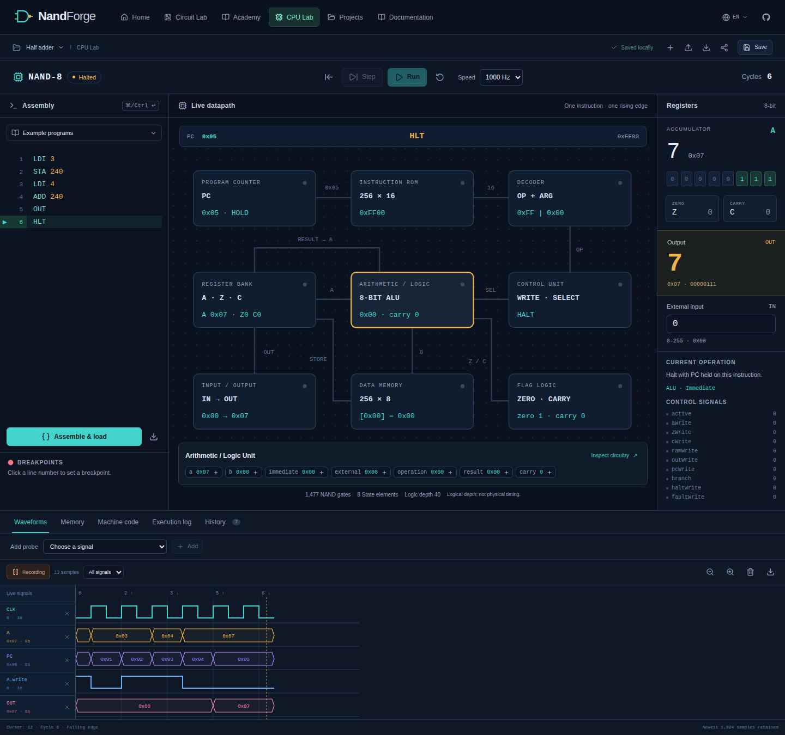
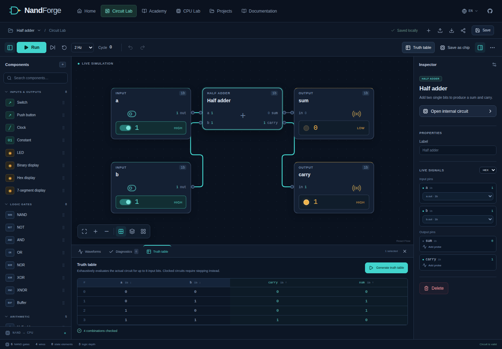
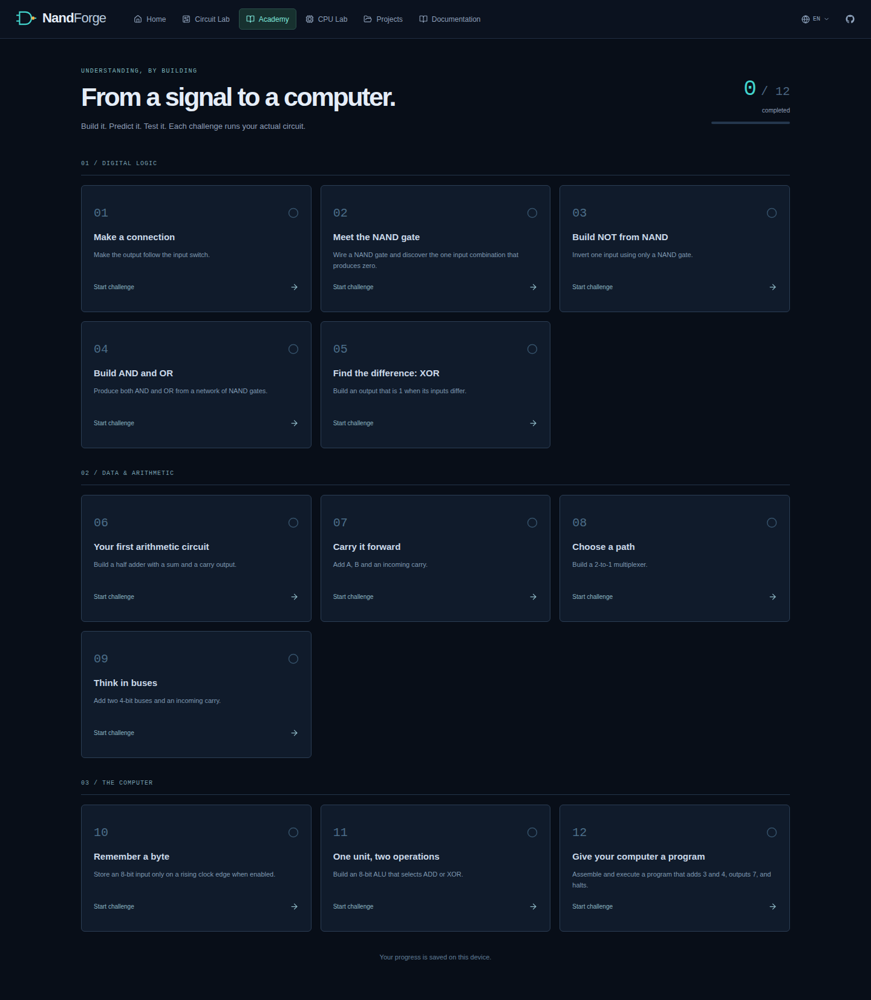
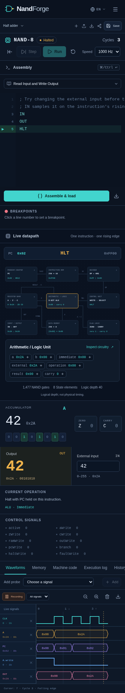

# NandForge

### Bir bilgisayar kur. Her bitini anla.

**[English](README.md)** · **[GitHub Pages](https://berkopan.github.io/NandForge/)** · **[Mimari](docs/ARCHITECTURE.md)** · **[Komut kümesi](docs/ISA.md)** · **[Katkıda bulunma](docs/CONTRIBUTING.md)**

NandForge, tarayıcıda çalışan bir sayısal devre ve bilgisayar mühendisliği laboratuvarıdır. NAND kapılarını bağlayabilir, yeniden kullanılabilir çipler oluşturabilir, saatli durum değişimlerini inceleyebilir ve görsel düzenleyiciyle aynı devre motorunda çalışan 8 bitlik bir bilgisayarı programlayabilirsin.

Hesap, sunucu, API anahtarı veya harici hesaplama hizmeti gerekmez. Projeler ve ders ilerlemesi cihazında saklanır. Varsayılan arayüz dili İngilizcedir; üst çubuktan Türkçeye geçebilirsin.

## Çalışma alanları

| Alan | Neler yapabilirsin? |
| --- | --- |
| **Devre Lab** | Bileşen yerleştir, genişliği belirli pinleri bağla, girişleri değiştir, sinyalleri incele, özel çip oluştur ve derlenmiş devrenin karmaşıklığını ölç. |
| **CPU Lab** | Assembly derle, canlı veri yolunu izle, yazmaç ve RAM durumunu incele, durma/izleme noktaları ekle ve geçmiş durumları geri yükle. |
| **Akademi** | Kurduğun gerçek devreyi çalıştırarak doğrulanan 12 görevi tamamla. |
| **Projeler** | Yerel proje oluştur, adlandır, çoğalt, yeniden aç, içe/dışa aktar ve paylaş. 13 çalışan devre şablonundan başla. |
| **Dokümantasyon** | Modelin sınırlarını, çalışma mantığını, mimariyi ve komut referansını oku. |

Ana sayfadaki iki NAND kapılı AND önizlemesi de gerçek simülatörü kullanır: anahtarlar değiştiğinde gösterilen çıkış devreden hesaplanır.

## Ekran görüntüleri

`/NandForge/` altında çalışan üretim uygulamasından alındı.



*3 + 4 programı altı çevrim sonunda durdu. PC, HLT komutunda tutuluyor; OUT, 7 değerini koruyor. Dalga biçimleri gerçek yürütmeyi gösteriyor.*

<details>
<summary>Ana sayfa, Devre Lab, Akademi ve mobil ekran görüntüleri</summary>

### Devre Lab



*Düzenleyici, pin inceleyicisi ve doğruluk tablosu aynı çalışan devreyi gözlemliyor.*

### Ana sayfa


### Akademi



### Mobil CPU Lab



*Giriş/çıkış örneği, 390 piksel genişliğindeki görünümde aynı gerçek devre CPU'suyla çalışıyor.*

</details>

## Yerel ortamda çalıştırma

**Node.js 24** ve npm kullan. CI da aynı Node ana sürümüyle çalışır.

```sh
git clone https://github.com/Berkopan/NandForge.git
cd NandForge
npm ci
npm run dev
```

**[http://localhost:4173/NandForge/](http://localhost:4173/NandForge/)** adresini aç. Büyük **N** ve **F** kasıtlıdır: depo `Berkopan/NandForge`, yayın yolu `/NandForge/` şeklindedir.

### Geliştirme komutları

| Komut | İşlev |
| --- | --- |
| `npm run dev` | 4173 portunda Vite geliştirme sunucusu. |
| `npm run typecheck` | İndeks erişimleri dahil katı TypeScript denetimi. |
| `npm run lint` | Kaynak, test ve yapılandırma dosyalarında ESLint. |
| `npm test` | Simülatör, aritmetik, assembler, CPU, düzenleyici, Akademi, hata ayıklama ve kalıcılık testleri. |
| `npm run test:watch` | Dosyalar değişirken birim testlerini yeniden çalıştırma. |
| `npm run build` | Tip denetimi ve `dist/` içinde üretim derlemesi. |
| `npm run preview` | Üretim derlemesini yerel olarak sunma. |
| `npm run test:e2e` | 4174 portundaki üretim derlemesinde Playwright iş akışları. |
| `npm run bench` | Yapılandırılmış çıktı üreten tekrarlanabilir performans ölçümleri. |

Tarayıcı testleri için önce motoru yükle:

```sh
npm run build
npx playwright install chromium
npm run test:e2e
```

CI'daki Chromium, Firefox ve WebKit kapsamını yerel olarak çalıştırmak için:

```sh
npx playwright install --with-deps chromium firefox webkit
PLAYWRIGHT_ALL_BROWSERS=1 npm run test:e2e
```

## İlk devreni kur

1. **Projeler → Yeni proje** üzerinden boş bir devre aç veya şablonlardan **İlk AND kapın** seçeneğini kullan.
2. **Devre Lab** içinde iki **Anahtar**, bir **AND** kapısı ve bir **LED** ekle. Bileşene tıklayabilir veya ızgaraya sürükleyebilirsin.
3. İlk anahtarın `out` pinini kapının `a` pinine, ikincisini `b` pinine bağla. Kapının `out` pinini LED'in `in` pinine bağla.
4. Anahtarları değiştir. LED yalnızca iki giriş de `1` olduğunda `1` olur.
5. **Doğruluk tablosu → Doğruluk tablosu oluştur** ile bütün giriş birleşimlerini gerçek simülatörde dene.
6. AND kapısını seçip **İç devreyi aç** düğmesine bas. AND'i oluşturan iki NAND kapısını görebilirsin.

Çıkış pinleri sağda, giriş pinleri soldadır. Bir çıkış birden fazla girişi sürebilir; bir girişin yalnızca bir kaynağı olabilir. Bağlanan pinlerin bit genişlikleri eşit olmalıdır. Sürüklemeye alternatif olarak bileşeni seçip inceleyicideki giriş **Bağla** seçicilerini klavyeyle de kullanabilirsin.

### Bileşen kütüphanesi

| Kategori | Bileşenler |
| --- | --- |
| Giriş ve çıkış | Anahtar, basmalı düğme, saat, sabit, LED, ikili/onaltılı gösterge, 7 segment gösterge. |
| Mantık | NAND, NOT, AND, OR, NOR, XOR, XNOR, tampon. |
| Aritmetik | Yarım/tam toplayıcı, dalgalı elde toplayıcı, çıkarıcı, işaretsiz karşılaştırıcı. |
| Yönlendirme | Çoklayıcı, çoğullama çözücü, kod çözücü, veri yolu ayırıcı ve birleştirici. |
| Ardışıl | D flip-flop, etkinleştirmeli yazmaç, sayaç. |
| Bellek | Başlangıç içeriği düzenlenebilir idealleştirilmiş RAM ve ROM. |
| Özel | Projeyle saklanan ve iç içe kullanılabilen gerçek çip tanımları. |

Veri yolları **1–16 bit** genişliğindedir. İnceleyicide etiket, genişlik, başlangıç değeri, gösterim biçimi ve uygun bileşenlerde bellek ayarları bulunur. Çok bitli girişler işaretsiz onluk sayı kabul eder; sinyaller ikili veya onaltılı biçimde de incelenebilir. Ayırıcı ve birleştiricide `b0` en düşük anlamlı bittir. 7 segment göstergeler onaltılı basamakları gösterir.

### Düzenleme ve gözlem

- Tuvali kaydır, yakınlaştır, devreyi ekrana sığdır, yerleşimi düzenle; ızgaraya hizalamayı ve küçük haritayı açıp kapat.
- **Shift + sürükle** ile çoklu seçim yap. **Shift**, **Ctrl** veya **⌘** ile seçime bileşen ekle.
- Seçimi kopyala, yapıştır, çoğalt, sil veya değişiklikleri geri al. Bir bileşen silinince ona bağlı kablolar da kaldırılır.
- Pinlerde ve seçili kablolarda gerçek değerleri oku. Etkin sinyaller hem renkle hem sayısal değerle belirtilir.
- Eksik girişler, genişlik uyuşmazlıkları, çoklu sürücüler, bozuk modüller ve desteklenmeyen birleşimsel döngüler için tanılama panelini aç.
- Derlenmiş NAND kapısı sayısını, kablo sayısını, durum öğelerini ve mantık derinliğini incele. Derinlik fiziksel gecikme ölçümü değildir.

| İşlem | Kısayol |
| --- | --- |
| Geri al / yinele | `Ctrl/⌘ Z` / `Ctrl/⌘ Shift Z` |
| Kopyala / yapıştır / çoğalt | `Ctrl/⌘ C` / `Ctrl/⌘ V` / `Ctrl/⌘ D` |
| Tümünü seç | `Ctrl/⌘ A` |
| Seçimi sil | `Delete` veya `Backspace` |
| Devreyi çalıştır / duraklat | `Boşluk` |
| Devreyi sığdır | `F` |
| Seçimi taşı | Ok tuşları; `Alt` ile bir birimlik adım |
| Projeyi kaydet | `Ctrl/⌘ S` |

Metin alanlarında normal yazı düzenleme kısayolları korunur. Sağ tık menüsünde de karşılık gelen devre işlemleri bulunur.

### Özel çipler ve canlı iç devreler

**Çip olarak kaydet** düğmesiyle bir ad verip tüm devreyi veya seçili bileşenleri kullan. INPUT ve OUTPUT bileşenleri genişliği belirli portlara dönüşür. Bir alt devre seçtiysen sınırı geçen bağlantılardan giriş/çıkış portları oluşturulur; ortak kaynağın birden fazla pini sürmesi korunur. Çipin geçerli devresi ve en az bir çıkışı olmalıdır.

Tanım **Çiplerim** bölümünde görünür. Örneklerini yerleştirip adlandırılmış portlarını bağla. Yeni projeler etkin projenin özel çip kütüphanesinin bir kopyasını alır; proje çoğaltma da tanımları taşır. Her projenin JSON dosyası kendi çip tanımlarını içerdiği için paylaşımda mantık devresi de birlikte gider.

**İç devreyi aç**, seçilen örneğin aynı simülatördeki hiyerarşik yolunu okur. İki çip örneğinin yazmaç veya bellek durumları farklıysa bu fark içeride de doğru görünür. Üst devrenin durumu ve geri alma geçmişi korunur. İç görünüm salt okunurdur; giriş değiştirmek veya saat adımı atmak için üst devreye dön.

## Simülasyonun çalışma mantığı

Mantık işlemlerini React arayüzü yürütmez. [`src/core/`](src/core/) DOM'dan bağımsız saf bir TypeScript motorudur:

1. Bileşenleri, pinleri, genişlikleri, sürücüleri ve modül sınırlarını doğrular.
2. Hiyerarşik çipleri ortak temsile açar. Birleşimsel hazır bileşenler NAND işlemlerine indirgenir; ayırıcı ve birleştiriciler bit bağlantılarını temsil eder.
3. Bağımlılıklardan deterministik bir değerlendirme sırası çıkarır. Saatli durum üzerinden geri beslemeye izin verir, desteklenmeyen birleşimsel döngüleri reddeder.
4. Sinyalleri yoğun indeksli bellekte değerlendirir. Değişmeyen değerlerin yeniden okunması hesaplamayı tekrar başlatmaz.
5. Saat kenarından önce kararlı girişleri örnekler, etkilenen durum öğelerini birlikte günceller ve birleşimsel mantığı yeniden değerlendirir.
6. Girişleri, yazmaçları, belleği, saatleri ve çevrim sayısını içeren serileştirilebilir durum kayıtlarını geri yükler.

Bir saat adımı tam bir **düşük → yüksek → düşük** darbesi üretir. Dalga kaydı gerçek yükselen ve düşen fazları örnekleyebilir. Duraklatılmışken veri girişini değiştirmek yazmaca kendiliğinden saat uygulamaz.

Model iki değerli, işaretsiz sayısal sinyaller kullanır. D flip-flop ve bellek açıkça belirtilmiş ideal öğelerdir. Analog gerilim, transistör davranışı veya fiziksel yayılma gecikmesi modellenmez. Kesin kurallar [Simülasyon semantiği](docs/SIMULATION.md) belgesindedir.

## Gerçek 8 bit CPU

NandForge'un akümülatör bilgisayarı, Devre Lab'daki bileşen ve derleyiciyle oluşturulmuş hiyerarşik bir devredir. Komut ROM'u kod çözücüyü, kontrol denklemlerini, ALU'yu, yazmaçları, program sayacını ve bellek yazımlarını sürer. [`CpuMachine`](src/cpu/machine.ts) ortak simülatörü sarar ve gerçek sinyalleri okur; komutları çalıştıran bir JavaScript opcode yorumlayıcısı içermez.

| Parça | Kapasite veya davranış |
| --- | --- |
| Akümülatör ve program sayacı | Her biri 8 bit. |
| Bayraklar | Saklanan sıfır `Z` ve elde `C`. |
| Giriş ve çıkış | Kullanıcı değiştirene kadar tutulan giriş baytı; ayrı, saatli çıkış yazmacı. |
| Veri RAM'i | 256 × 8 bit. |
| Komut ROM'u | 256 × 16 bit. |
| Komut biçimi | Üst bayt işlem kodu, alt bayt doğrudan değer veya adres. |
| Yürütme | Bir atomik yükselen kenarda bir komut. |
| Durma ve hata | HLT mevcut komut adresini tutar; ayrılmış opcode görünür hata durumuna geçirir. |

Derlenmiş CPU'da **1.477 tek bit NAND kapısı** bulunur. Çok bitli NAND'lar sözcük işlemleriyle birlikte değerlendirildiğinden kapı sayısı ile planlanmış işlem sayısı farklıdır. Ölçülen yapı ve yöntem [Performans ölçümleri](docs/BENCHMARKS.md) belgesindedir.

### İlk program: 3 + 4

**CPU Lab** içinde **İki Sayıyı Topla** örneğini seç. Kaynağı değiştirdiysen **Derle ve yükle** düğmesine bas. Komutları adımla veya çalıştır:

```asm
LDI 3
STA 240
LDI 4
ADD 240
OUT
HLT
```

`STA 240` ilk sayıyı RAM'e yazar. `ADD 240` bu sayıyı akümülatöre ekler. `OUT`, **7** sonucunu çıkış yazmacına alır; `HLT` yürütmeyi durdurur.

Komutlar: `NOP`, `LDI`, `LDA`, `STA`, `ADD`, `SUB`, `AND`, `OR`, `XOR`, `NOT`, `SHL`, `SHR`, `JMP`, `JZ`, `JNZ`, `JC`, `OUT`, `IN`, `HLT`.

Assembler; etiketleri, yorumları, onluk/onaltılı/ikili sayıları, ifadeleri, `.EQU`, `.ORG` ve `.WORD` yönergelerini destekler. Hatalar satır ve sütunuyla gösterilir; makine kodu listesi adresleri kaynak satırlarıyla eşler.

Aritmetik 256 modunda sarar. ADD taşmada Carry'yi 1 yapar. CPU'nun SUB komutu **ödünç oluşmadığında** Carry'yi 1 yapar. SHL/SHR dışarı kaydırılan biti Carry'de saklar. A'ya yazan komutlar Zero'yu günceller; diğer bayrak değişiklikleri yalnızca tanımlanan komutlarda gerçekleşir. Bağımsız SUBTRACTOR bileşeninin `cout` pini **ödünç çıkışı**dır; CPU SUB komutunun **ödünç yok Carry** kuralıyla karıştırılmamalıdır. Ayrıntılar [ISA](docs/ISA.md) ve [CPU mimarisi](docs/CPU.md) belgelerindedir.

Sekiz örnek program; toplama, ileri/geri sayma, dallanma, toplam döngüsü, Fibonacci, bit işlemleri ve giriş/çıkışı kapsar.

### Hata ayıklama ve dalga biçimleri

- Kaynak satır numarasına veya makine kodu adresine tıklayarak durma noktası ekle. Yürütme ilgili komuttan önce durur; devam edildiğinde o komut çalıştırılabilir.
- Adres girerek veya RAM hücresine tıklayarak bellek izleme noktası ekle. Hücre değiştiğinde yürütme duraklar.
- A, PC, bayraklar, OUT, giriş, RAM, mevcut komut, yazma etkinleştirmeleri, dallanma ve ALU seçimini incele.
- Geçmişte ileri/geri adım at veya kaydırıcı/kartlarla bir durumu geri yükle. Önceki durumdan yeni yürütme başlatılınca eski gelecek silinir.
- Çıkışlara ve alt sistem pinlerine prob ekle. Gerçek saat, yazmaç, veri yolu ve kontrol örneklerini imleç, yakınlaştırma, yatay kaydırma ve JSON dışa aktarmayla incele.
- `Ctrl/⌘ Enter`: derle ve yükle; `F10`: adım; `Shift F10`: bir adım geri; `F5`: çalıştır/duraklat.

CPU geçmişi ve yürütme günlüğü ayrı ayrı son **256** kaydı tutar. Dalga biçimleri son **1.024** örneği saklar; CPU en fazla **24** eşzamanlı prob destekler. Başka durma nedeni yoksa CPU bir çalıştırmada **100.000** komuttan, Devre Lab **10.000** saat adımından sonra duraklar. Çalıştır düğmesiyle devam edilebilir.

Devre düzenleyicisinin geri alma mekanizması belgeyi değiştirir. CPU geçmişi ise simülasyon durumunu geri yükler. Bu iki mekanizma ayrıdır.

## Yaparak öğren

Akademideki 12 görev sırasıyla bağlantı, NAND, NAND'dan NOT, AND/OR, XOR, yarım toplayıcı, tam toplayıcı, çoklayıcı, veri yolu toplaması, saatli yazmaç, ADD/XOR seçen ALU ve ilk CPU programını kapsar.

Her görev açıklama, düzenlenebilir başlangıç devresi, beklenen davranış, ipucu ve geri bildirim sağlar. Doğrulama gerçek devreyi bütün birleşimlerle veya deterministik test vektörleriyle çalıştırır. Yazmaç görevinde saat ve etkinleştirme dizileri denenir. Bileşen adları tek başına başarı sayılmaz. Yalnız NAND isteyen görevlerde izin verilen bileşenler de denetlenir. Ders devresi serbest projeye taşınabilir; ilerleme yerel olarak kaydedilir.

## Projeler, taşınabilirlik ve gizlilik

Proje belgesi; sürümlenmiş devre grafiğini, çip tanımlarını, assembly kaynağını ve meta verileri içerir. Projeler IndexedDB'de, tercihler ve ders ilerlemesi yerel depolamada tutulur. Değişiklikler otomatik kaydedilir; **Kaydet** veya `Ctrl/⌘ S` hemen kayıt ister.

Taşınabilir kopya için **JSON dışa aktar** kullan. **JSON içe aktar**, belgeyi doğrulayıp ayrı bir yerel proje oluşturur. Dosya sınırı **4 MiB**'dır; grafiğe, iç içe yapıya ve açılmış bileşen sayısına da sınır uygulanır. İçe aktarılan içerik JavaScript olarak çalıştırılmaz.

Küçük projelerde **Paylaşım bağlantısını kopyala**, projeyi sıkıştırıp URL'nin `#` bölümüne yerleştirir. Açılan pencerede URL görünür; pano erişimi yoksa bağlantıyı seçip elle kopyalayabilirsin. Bağlantının kendisi proje verisini taşır; sunucuya proje yüklenmez. Kodlanmış veri en fazla **12.000 karakter**, açılmış veri en fazla içe aktarma sınırı kadardır. Büyük projeler JSON dosyasıyla paylaşılır.

Dışa aktarma; topolojiyi, ayarları, özel çipleri ve kaynak kodu korur. Canlı simülatör durumu ve geçici hata ayıklama geçmişi proje kaydının alanları değildir; gözlem kayıtları için dalga dışa aktarmasını kullan. Tarayıcı verisi profil ve site adresine bağlıdır. Yedekleme veya başka cihazda çalışma için dosya dışa aktar.

## Doğrulama ve performans

Testler; kapı doğruluk tablolarını, NAND bileşimlerini, aritmetiği, veri yollarını, doğrulamayı, hiyerarşiyi, saat kenarlarını, belleği, deterministik durumları, düzenleyici işlemlerini, Akademiyi, kalıcılığı ve hata ayıklama geçmişini kapsar.

CPU'nun bağımsız referans modeli yalnızca [`tests/cpu/reference.ts`](tests/cpu/reference.ts) altındadır; tarayıcı uygulamasına aktarılmaz. Tüm opcode'lar, bütün bayt çiftlerinde toplama/çıkarma, komut komut deterministik karşılaştırmalar ve örneklerin bütün OUT dizileri denetlenir. Tarayıcı testleri `/NandForge/` yolundaki gerçek üretim derlemesini kullanır.

Ölçümler; dört NAND'lı XOR, 512 ve 8.192 kapılı ağlar, CPU yürütmesi ve sürekli dalga/geçmiş kaydını kapsar. [Sonuçlar ve sınırlar](docs/BENCHMARKS.md) tek bir çalışma ortamına aittir; evrensel tarayıcı FPS veya donanım frekansı garantisi değildir.

## GitHub Pages yayını

[GitHub Actions iş akışı](.github/workflows/ci.yml), push ve pull request değişikliklerini doğrular. Varsayılan daldaki başarılı çalıştırma `dist/` çıktısını GitHub Pages'e yollar. Pull request doğrulaması yayın yapmaz.

**CI ve Pages yayını 17 Ekim 2026 tarihinde başarıyla tamamlandı:** [39064679103 numaralı çalıştırma](https://github.com/Berkopan/NandForge/actions/runs/39064679103), son kod olan `fcb591e` sürümünü doğrulayıp Pages dağıtımını tamamladı. Doğrulama işindeki 14 adımın ve yayın işindeki 4 adımın tamamı başarılı. Pages kaynağı zaten GitHub Actions; depo sahibinin ayar değiştirmesi gerekmiyor. **[https://berkopan.github.io/NandForge/](https://berkopan.github.io/NandForge/)** adresindeki yayın da tarayıcıda doğrulandı: ana sayfa ve Devre Lab eksiksiz doğru AND tablosunu üretti; gerçek CPU altı çevrim sonunda A=7, OUT=7 ve PC=0x05 durumunda durdu. [Canlı yayın kanıtı](docs/DEPLOYMENT.md#observed-publication). Uygulama yolları `#/cpu` gibi hash gezinmesi kullanır.

Başka bir alt yolda sunacaksan derlemede `NANDFORGE_BASE` ayarla ve üretilen dosyaları o yolda dene. Ayrıntılar [Yayın kılavuzunda](docs/DEPLOYMENT.md).

## Teknik sınırlar

Devre tuvali öncelikle masaüstü için tasarlanmıştır. Duyarlı düzen, kapanabilir paneller, pin seçicileri ve CPU inceleme görünümü dar ekranlarda alternatif sağlar. Çok büyük grafikleri çizmek, karşılık gelen derlenmiş devreyi simüle etmekten daha maliyetli olabilir. Yürütme tarayıcının ana iş parçacığındadır; Web Worker veya fiziksel zamanlama simülasyonu iddiası yoktur.

Otomatik doğruluk tablosu en fazla sekiz giriş biti içeren birleşimsel devrelerde ve sınırlı işlem bütçesiyle çalışır. Daha geniş veya saatli devreler doğrudan girişler, saat adımları, problar ve davranış testleriyle incelenir.

## Kaynak yapısı ve katkı

| Dizin | Sorumluluk |
| --- | --- |
| `src/core/` | Devre modeli, bileşenler, derleyici ve simülatör. |
| `src/editor/` | Görsel düzenleme, inceleyici, çip oluşturma, dalga arayüzü. |
| `src/cpu/` | Gerçek ALU, kod çözücü, kontrol, yazmaç ve CPU adaptörü. |
| `src/assembler/` | Ayrıştırıcı, ifadeler, semboller, assembler ve örnekler. |
| `src/debugger/` | CPU çalışma alanı, durma/izleme noktaları ve sınırlı geçmiş. |
| `src/academy/` | Dersler ve gerçek devre doğrulaması. |
| `src/persistence/` | Sürümlenmiş projeler, doğrulama, kayıt ve paylaşım. |
| `src/i18n/` | Ortak İngilizce/Türkçe metinler ve şablonlar. |
| `src/views/` | Ana sayfa, Akademi, Projeler ve dokümantasyon. |
| `tests/`, `docs/` | Doğrulama, mimari, semantik, ISA ve performans belgeleri. |

Teknoloji: TypeScript, React, Vite, React Flow, Lucide, Vitest ve Playwright; stiller düz CSS ile yazılmıştır.

Katkı için [Contributing](docs/CONTRIBUTING.md), [Mimari](docs/ARCHITECTURE.md) ve [ortak sözleşmeleri](docs/CONTRACTS.md) incele. NandForge [MIT lisansıyla](LICENSE) yayımlanır.
