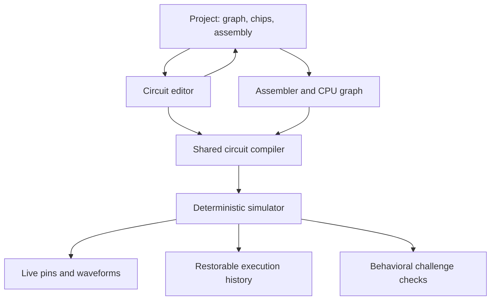

# NandForge architecture

NandForge is a static browser application in which the circuit editor, reusable chips, Academy challenges, and programmable computer share one digital simulator. The saved circuit graph is executable data: changing an ALU wire changes the CPU's result. The UI reads the executing graph's pins and snapshots rather than maintaining another set of simulated register values.

The application is implemented with TypeScript, React, Vite, and React Flow. Hash routes keep every page under the case-sensitive `/NandForge/` project path. There is no application server, account system, remote project database, or runtime code execution from imported documents. [Package configuration](../package.json), [application shell](../src/App.tsx), [Vite configuration](../vite.config.ts).

## System boundaries

Every execution path reaches the same compiler and simulator. The assembler emits ROM words; the CPU graph decodes those words through gates. Academy logic exercises the candidate graph with input vectors or clock sequences. The debugger records the simulator's state and actual phase observations. [Core exports](../src/core/index.ts), [CPU construction](../src/cpu/architecture.ts), [Academy verification](../src/academy/verify.ts), [debugger session](../src/debugger/session.ts).

## Code organization

| Area | Responsibilities | Entry points |
| --- | --- | --- |
| Application | Hash navigation, current project, autosave, language, notices, project actions | `src/App.tsx`, `src/views/` |
| Core model and library | Typed circuits, component specifications, NAND-derived chips, templates | `src/core/types.ts`, `catalog.ts`, `chips.ts`, `templates.ts` |
| Compiler and runtime | Validation, hierarchy expansion, electrical nets, scheduling, atomic state, snapshots | `src/core/validation.ts`, `compiler.ts`, `simulator.ts` |
| Circuit editor | Graph interaction, wiring, selection, undo/redo, reusable chip extraction, live inspection | `src/editor/CircuitEditor.tsx`, `model.ts`, `useCircuitRuntime.ts` |
| Computer | Fixed ISA, actual decoder/control/ALU/register graph, thin simulator adapter | `src/cpu/isa.ts`, `architecture.ts`, `alu.ts`, `machine.ts` |
| Assembly | Symbol resolution, expressions, directives, encoded ROM, positioned errors, examples | `src/assembler/` |
| Debugger | CPU controls, breakpoints, watchpoints, bounded history, traces and logs | `src/debugger/CpuLab.tsx`, `session.ts` |
| Academy | Twelve bilingual lessons, starter circuits, output-based checks | `src/academy/lessons.ts`, `verify.ts`, `src/views/Academy.tsx` |
| Persistence | Versioned JSON, document limits, local storage, sharing | `src/persistence/projects.ts`, `storage.ts` |
| Verification | Unit, exhaustive, differential and browser workflows | `tests/`, `scripts/benchmark.ts` |

## Canonical circuit model

A `Circuit` contains uniquely identified components and pin-to-pin connections. Each component has a type, configuration, display position, and optional label. A `ChipDefinition` adds a named interface to an ordinary circuit: input ports bind to internal INPUT components, and output ports bind to internal OUTPUT components. This is the same representation used for saved user chips and generated CPU subsystems. [Types](../src/core/types.ts).

Every signal has an explicit unsigned width from one through sixteen bits. Output fan-out is allowed; an input has one driver of the same width. SPLIT and JOIN explicitly connect individual bits to buses, with `b0` as the least significant bit. The compiler supplies only documented optional defaults, such as an adder's zero carry-in; missing required wiring produces a diagnosis.

The editor's display positions and labels are independent of electrical behavior. Clipboard operations remap component and connection identifiers, retain internal wires, and omit dangling external connections. Saving a selected subgraph as a chip creates typed boundary ports and retains the actual internal graph. [Editor graph operations](../src/editor/model.ts), [graph operation tests](../tests/editor/model.test.ts).

## Compilation and simulation

Compilation validates definitions, expands built-in and custom hierarchy, gives each instance a distinct path, joins wire and port aliases into electrical nets, and computes a stable topological schedule. DFF outputs and memory state form explicit state boundaries. A combinational cycle is rejected instead of relying on a guessed convergence limit. Public pin references retain access to module boundaries and expanded internal paths. [Compiler](../src/core/compiler.ts), [validation](../src/core/validation.ts).

The runtime stores values in typed arrays and evaluates a compact schedule after a source or state change. Repeated unchanged reads skip netlist work. The combinational operation vocabulary is NAND, SPLIT, JOIN, RAM read, and ROM read; constants, external inputs, clocks and sequential elements have separate descriptors. All other Boolean and arithmetic components expand into NAND-derived circuits. A vector NAND evaluates independent bit gates together, which explains why NAND gate counts can exceed scheduled operation counts.

State advances on explicit source-clock transitions. All enabled DFFs and RAM writes capture data, addresses and enables from the same stable pre-edge state; selected changes commit together. A complete step takes clocks low, high, then low and exposes settled rising and falling observations. Ordinary data edits settle combinational signals without changing stored register values. See [SIMULATION.md](SIMULATION.md) for the exact gated-clock boundary, memory ordering, arithmetic conventions and diagnostic codes.

This is an idealized two-valued synchronous model. DFFs and memory are declared primitives. There is no transistor timing, metastability, analog voltage, physical delay, asynchronous clock cascade, or four-state signal model. Logical depth is a circuit statistic, not a measured delay.

## The actual computer

`buildCpuCircuit()` constructs the decoder, control logic, ALU, register bank, program counter, flag logic, I/O, RAM and ROM as inspectable shared-model components. The ROM contains 256 sixteen-bit words. The upper byte selects one of nineteen instructions; the lower byte is an immediate value or address. RAM contains 256 bytes. A, PC and OUT are eight-bit registers; Z, C, HALT and FAULT are one-bit state. IN is an externally held eight-bit source sampled by the IN instruction. [CPU architecture](../src/cpu/architecture.ts), [instruction reference](ISA.md).

The decoder implements opcode minterms, the control unit implements Boolean write-enable equations, and the ALU uses NAND-derived arithmetic and bitwise circuits plus wiring for shifts. Register enables select old or new values before the DFF boundary. The CPU uses one architectural rising edge per instruction, and conditional branches use the previously stored flags. Reserved opcode bytes latch a fault and halt without committing data writes.

`CpuMachine` loads images, reads real pins, steps the shared simulator and restores snapshots. It does not dispatch opcode handlers. The independent instruction interpreter exists only in `tests/cpu/reference.ts`. A separate integrity test runs the six-word 3 + 4 program directly through `Simulator`, bypasses `CpuMachine`, and then changes a real ALU wire to demonstrate that the output changes from 7 to 4. [Adapter](../src/cpu/machine.ts), [integrity tests](../tests/core/cpu-integrity.test.ts), [CPU design](CPU.md).

## UI and session ownership

The application owns serializable project state: circuit topology and configuration, reusable chip definitions, assembly source, name, identifiers and timestamps. Editor input changes, selection, running state, execution history and CPU breakpoints are transient session data. A language change does not replace a mounted simulator. Moving circuit components does not recompile the graph; topology or configuration edits intentionally do. [Application](../src/App.tsx), [runtime hook](../src/editor/useCircuitRuntime.ts).

Opening an internal circuit retains the same simulator instance. A path prefix scopes reads to the selected chip instance, including nested registers and memory. The parent editor remains mounted during its internal inspection. CPU circuitry inspection also receives the actual CPU simulator, so it cannot display a separately reset approximation of the processor. [Editor](../src/editor/CircuitEditor.tsx), [CPU view](../src/debugger/CpuLab.tsx).

Navigating away from Circuit Lab or CPU Lab unmounts that view. Returning restores the project's graph and source, then starts a new transient simulation session. CPU source is not replaced by the default example during navigation; its saved text is reassembled on entry. Register contents, waveform captures, breakpoints, and time-travel history are not persisted across route changes or browser reloads. This boundary is deliberate and should be kept explicit in future UI changes.

Within a CPU session, editing source pauses execution and disables Run/Step until successful assembly and load. A failed assembly leaves the previous machine intact while displaying positioned errors. Loading a program or resetting execution clears the session's execution history. History navigation pauses execution and restores the actual machine snapshot; it does not reverse instructions.

## Debugger and waveform data

A CPU snapshot includes the complete core snapshot plus the loaded ROM and initial RAM image needed for Reset. The core snapshot includes a topology/configuration fingerprint, cycle, source inputs, DFF state, memories, source clocks and observed clock levels. Restore validates the complete object before mutation and reevaluates derived nets. [Snapshot implementation](../src/core/simulator.ts).

`DebuggerSession` stores at most 256 snapshots and 256 log entries, while waveform helpers retain at most 1,024 samples. A session permits at most 24 probes. Breakpoints stop before the named PC executes; memory watchpoints stop after an observed RAM value changes. Rewinding and executing again discards the abandoned future. Real clock callbacks supply trace samples, including high and low levels, register outputs and control signals. Recording can be paused independently of execution. [Debugger](../src/debugger/session.ts), [waveform model](../src/editor/waveforms.ts).

The CPU UI limits work to small timer slices rather than blocking indefinitely in a Run handler. A run has a 100,000-instruction guard. Simulation remains on the main JavaScript thread; the implementation does not claim a Web Worker or per-net event-driven scheduler. Measured engine and history workloads, including an 8,192-NAND circuit, are documented separately in [BENCHMARKS.md](BENCHMARKS.md).

## Local projects and import boundaries

Project schema version 1 stores the circuit, chips and assembly together. IndexedDB is the normal project store; a localStorage fallback is used when IndexedDB is unavailable as an API. Language and Academy progress are local preferences. The app debounces autosave for 650 ms, offers explicit Save, attempts a save when the document becomes hidden, and preserves a dirty-state warning for unsaved changes. Switching projects awaits a pending dirty project's save before replacing it. [Project schema](../src/persistence/projects.ts), [storage](../src/persistence/storage.ts), [application lifecycle](../src/App.tsx).

External JSON import uses strict typed and semantic validation, permitting deliberately incomplete required connections so unfinished projects remain portable. Internal storage additionally accepts safe typed editing drafts with recoverable semantic errors, such as a width mismatch during rewiring. Those circuits reopen with diagnostics and unavailable output values until repaired. Schema, prototype-key, identifier, reference, interface, recursion, and resource checks remain enforced in both modes.

Limits include a 4 MiB project document, 128 saved chips, 10,000 components and 40,000 connections per parsed definition, a sixteen-level project hierarchy, and a 50,000-component custom expansion bound. The core applies independent compiled-node and aggregate-memory limits. Sharing encodes a bounded project payload in a URL fragment and needs no backend. Imported data is never evaluated as JavaScript.

An unreadable stored record does not hide other projects. Listing isolates malformed records, exposes their count for a recovery notice, and leaves the original raw entries in storage. Fallback saves and deletes preserve unreadable records and refuse to overwrite a malformed storage envelope. [Draft and recovery tests](../tests/persistence/draft-storage.test.ts), [document validation tests](../tests/persistence/projects.test.ts).

## Delivery and verification

Vite builds static assets with `/NandForge/` as the default base. GitHub Actions validates types, lint, unit/exhaustive/differential tests, production assets and three browser engines before publishing a Pages artifact from the default branch. Hash routing avoids requiring server-side route rewrites. [Workflow](../.github/workflows/ci.yml), [deployment guide](DEPLOYMENT.md).

The existence of deployment code is separate from a successful deployment. Current observed results, remaining acceptance checks, and live-site evidence belong in [IMPLEMENTATION_STATUS.md](IMPLEMENTATION_STATUS.md) and its [machine-readable companion](implementation-status.json). [ENGINEERING_AUDIT.md](ENGINEERING_AUDIT.md) records the independent behavioral checks and defects resolved during implementation.

A late review of primary educational-tool references is documented in [DESIGN_REFERENCES.md](DESIGN_REFERENCES.md). It relates published teaching/interface ideas to the choices already implemented here and is explicitly separate from the implementation chronology.
